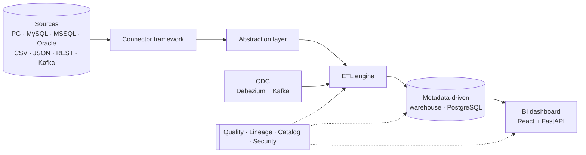

<div align="center">


### One data platform, any database.

Connect any source, run vendor-neutral ETL and CDC, auto-build a PostgreSQL warehouse,<br>
and explore it in a self-service BI dashboard.

[](https://github.com/jeylani-2526/subop/actions/workflows/ci.yml)
[](docs/milestones/)
[](services/requirements-dev.txt)
[](docker-compose.yml)
[](LICENSE)

[**Quickstart**](#-quickstart) · [**Architecture**](#-architecture) · [**Roadmap**](#-roadmap) · [**Docs**](docs/) · [**Contributing**](CONTRIBUTING.md)

</div>

> [!NOTE]
> **Prototype, month 7 of 12.** M1 to M8 are delivered. The metadata-driven warehouse (M8) closes on 30 Nov 2026,
> and the BI dashboard builder (M9) runs 1 to 28 Dec 2026. Interfaces may still change.

## ✨ Why SUBOP

| Pain in most data stacks | What SUBOP does |
|---|---|
| ETL tied to one database vendor | A database abstraction layer: switch engines with zero pipeline code change |
| Data scattered across silos | One connector framework for PostgreSQL, MySQL, MSSQL, Oracle, SQLite, CSV, JSON, REST and Kafka |
| Batch-only data movement | Change data capture with Debezium and Kafka (**p95 latency 650 ms**, target under 30 s) |
| Hand-written warehouse SQL | Fact, dimension and SCD tables generated from metadata |
| Expensive BI licences, no governance | Self-service dashboards, plus data quality, lineage, catalog and RBAC built in |

## 🏗️ Architecture



Full design: [`docs/architecture/`](docs/architecture/) · deployment topology: [diagram](docs/architecture/diagrams/deployment_topology_diagram.png)

## 🚀 Quickstart

**Needs:** Docker Desktop 4+, Git, Python 3.10+, Node.js 18+ (dashboard only)

```bash
git clone https://github.com/jeylani-2526/subop.git && cd subop
cp .env.example .env
docker compose up -d
```

Then open the API docs at **http://localhost:8000/docs**.

<details>
<summary>All local services and ports</summary>

| Service | Address |
|---|---|
| SUBOP API (FastAPI) | http://localhost:8000 · docs at `/docs` |
| Kafka UI | http://localhost:8080 |
| Kafka Connect (Debezium) | http://localhost:8083 |
| pgAdmin | http://localhost:5050 |
| PostgreSQL | localhost:5433 |
| MySQL · MSSQL · Oracle | localhost:3306 · 1433 · 1521 |

</details>

<details>
<summary>Run the tests and the dashboard</summary>

```bash
pip install -r services/requirements-dev.txt && pytest -v
cd services/bi-dashboard/frontend && npm install && npm run dev
```

</details>

## 🧩 Modules

| Module | Code | Milestone | Status |
|---|---|---|---|
| Connector framework | [`services/connectors`](services/connectors) | M4, M6 | ✅ Done |
| Database abstraction layer | [`services/abstraction`](services/abstraction) | M4 | ✅ Done |
| ETL engine | [`services/etl_engine`](services/etl_engine) | M5 | ✅ Done |
| CDC / real-time | [`services/cdc`](services/cdc) | M7 | ✅ Done |
| Metadata-driven warehouse | [`services/warehouse`](services/warehouse) | M8 | 🟢 Wrapping up |
| BI dashboard | [`services/bi-dashboard`](services/bi-dashboard) | M9 | 🔜 Next |
| Data quality · lineage · catalog | [`services/data-quality`](services/data-quality) | M10 | ⏳ Planned |
| Security & compliance (KVKK/GDPR) | [`services/security`](services/security) | M11 | ⏳ Planned |

## 🗺️ Roadmap

```
M1 ██ M2 ██ M3 ██ M4 ██ M5 ██ M6 ██ M7 ██ M8 ▓▓ M9 ░░ M10 ░░ M11 ░░ M12 ░░
```

<details>
<summary>Milestone dates and owners</summary>

| # | Milestone | Dates | Status |
|---|---|---|---|
| M1 | Requirements | 11 May – 7 Jun 2026 | ✅ |
| M2 | Research & competitor analysis | 8 – 28 Jun 2026 | ✅ |
| M3 | Architecture & infrastructure | 29 Jun – 19 Jul 2026 | ✅ |
| M4 | Database abstraction layer | 20 Jul – 9 Aug 2026 | ✅ |
| M5 | ETL engine core | 10 Aug – 6 Sep 2026 | ✅ |
| M6 | Connector ecosystem | 7 Sep – 4 Oct 2026 | ✅ |
| M7 | CDC & streaming | 5 Oct – 2 Nov 2026 | ✅ |
| M8 | Metadata-driven warehouse | 3 – 30 Nov 2026 | 🟢 Closing |
| M9 | BI dashboard & analytics | 1 – 28 Dec 2026 | 🔜 |
| M10 | Quality, lineage & catalog | 29 Dec 2026 – 2 Feb 2027 | ⏳ |
| M11 | Security & integration | 3 Feb – 23 Mar 2027 | ⏳ |
| M12 | Pilot & final delivery | 24 Mar – 11 May 2027 | ⏳ |

Week-by-week detail: [`docs/milestones/`](docs/milestones/)
</details>

## 🎯 KPIs

| KPI | Target | Result |
|---|---|---|
| Connector coverage | 8+ working connectors | ✅ Met in M6 (8 connectors × 5 checks) |
| DB migration | Zero code change when switching engine | ✅ Demonstrated in M4 on PostgreSQL, MySQL and MSSQL ([record](docs/data-layer/abstraction_layer_readiness_v1.md)) |
| CDC latency | Under 30 s end to end | ✅ p95 650 ms, idle and active ([record](docs/planning/m8_kpi_validation.md)) |
| DW schema automation | 80% faster than manual | ❌ Not met in M8, re-measured in M9 ([record](docs/planning/m8_kpi_validation.md)) |
| ETL speed | 1M rows in under 5 min | ⏳ Pending, no measurement recorded yet |
| Abstraction overhead | ≥85% of native query speed | ⏳ Pending, no measurement recorded yet |
| Dashboard creation | Non-technical user, under 15 min | ⏳ M9 |
| Load test · uptime · pilot score | 5M rows · 99.5% · ≥4.0/5 | ⏳ M11 to M12 |

## 📚 Documentation

| Topic | Where |
|---|---|
| Architecture & decisions | [`docs/architecture`](docs/architecture/) |
| Connectors, abstraction, ETL contracts | [`docs/data-layer`](docs/data-layer/) |
| API specs | [`docs/api`](docs/api/) |
| Frontend design system | [`docs/frontend`](docs/frontend/) |
| Compliance (KVKK/GDPR) | [`docs/compliance`](docs/compliance/) |
| Milestone status and planning notes | [`docs/milestones`](docs/milestones/) · [`docs/planning`](docs/planning/) |
| Tech stack | [`docs/architecture`](docs/architecture/README.md#tech-stack) |
| Repository layout | [CONTRIBUTING.md](CONTRIBUTING.md#repository-layout) |

## 🤝 Contributing

Branch from `develop`, use `type(scope): message` commits, and open a PR for review.
The full workflow is in [CONTRIBUTING.md](CONTRIBUTING.md).

## 👥 Team

**Abdullah** (lead, data engineering) · **Beyza** (BI & UI/UX) · **Omer** (backend & infrastructure) · **Mert** (verification)

## 📄 License

[MIT](LICENSE)
